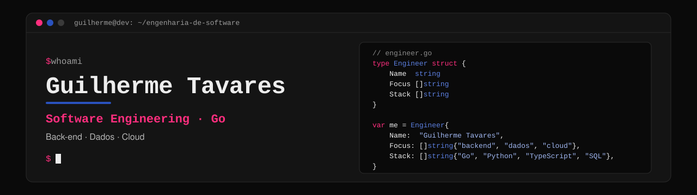

 

## `$ cat sobre-mim.md`

Estudo Ciência da Computação e sou estagiário de Pricing Strategy & Operations no LinkedIn. Nos meus projetos, escrevo APIs em Go com Postgres, testes e CI.

No estágio, construí de ponta a ponta o pipeline de dados do time no Microsoft Fabric. São notebooks PySpark que rodam todo dia e juntam Trino, Salesforce e planilhas numa fonte única. Em cima disso, um agente de IA responde as perguntas dos stakeholders que antes custavam cerca de uma hora de queries manuais cada.

Agora estou estudando Go com os exercícios de *The Go Programming Language*, de Donovan e Kernighan. Antes de Computação, cursei Engenharia de Produção, e meu interesse por melhoria de processos começou lá.

Se quiser conversar sobre back-end em Go, engenharia de dados ou automação, me chama no LinkedIn.

## `$ ls ./stack`

**Linguagens**

**Back-end e dados**

**Cloud e DevOps**

## `$ git log --projetos`

<table>
  <tr>
    <td width="50%" valign="top">
      <h3><a href="https://github.com/g-tavares14/go-auth-api">go-auth-api</a></h3>
      API de autenticação com JWT. Quando o usuário troca a senha, os tokens emitidos antes param de valer, e isso funciona sem tabela de revogação. O login tem rate limit por e-mail, por IP e pelo par e-mail + IP.
        
      
      
      
    </td>
    <td width="50%" valign="top">
      <h3><a href="https://github.com/g-tavares14/golang-library">golang-library</a></h3>
      API REST de livros e usuários organizada em camadas. O papel de user ou admin vem do token assinado, e o CI roda testes unitários, de integração e ponta a ponta contra um Postgres descartável.
        
      
      
      
    </td>
  </tr>
  <tr>
    <td width="50%" valign="top">
      <h3><a href="https://github.com/g-tavares14/preditor-de-falhas-ml">preditor-de-falhas-ml</a></h3>
      Projeto da faculdade que classifica rotas de rede como OK, RISCO ou FALHA a partir de medições do RIPE Atlas. Cada rota é comparada com o próprio histórico, e não com um limite fixo em ms. Os dados passam por um pipeline em PySpark, o modelo é um Random Forest do scikit-learn, e a API e o site rodam num servidor em Go.
        
      
      
      
    </td>
    <td width="50%" valign="top">
      <h3><a href="https://meirellespsico.com.br">Landing page de psicologia</a></h3>
      Site de uma psicóloga em HTML estático, num bucket S3 privado atrás do CloudFront, com a infraestrutura escrita em Go usando Pulumi. As visitas são contadas por um coletor próprio que não usa cookies. O Google Tag só carrega depois que o visitante aceita.
        
      
      
      
    </td>
  </tr>
  <tr>
    <td colspan="2" valign="top">
      <h3><a href="https://github.com/g-tavares14/codewars-sync">codewars-sync</a></h3>
      Extensão do Chrome para o Codewars. Quando eu envio uma kata, ela grava a solução e o enunciado no GitHub em um único commit. É ela que alimenta o <a href="https://github.com/g-tavares14/codewars-solutions">codewars-solutions</a>.
        
      
      
    </td>
  </tr>
</table>

## `$ cat conquistas.log`

| Resultado | O que foi |
|---|---|
| 1º lugar | Hackathon interna Small Group Training do LinkedIn. Fiquei com a parte técnica numa equipe de 6 pessoas |
| 40 s para 1,4 s | Tempo de resposta de consultas SQL no LinkedIn, depois que criei um cache |
| 1 semana para 30 min | Tempo para analisar distorções nos dados que chegam da origem |
| ~50 h por mês | Trabalho manual que um RPA em Python passou a fazer, validando cerca de 400 notas fiscais por mês |

## `$ gh contributions`

<picture>
  <source media="(prefers-color-scheme: dark)" srcset="https://raw.githubusercontent.com/g-tavares14/g-tavares14/output/github-snake-dark.svg" />
  <source media="(prefers-color-scheme: light)" srcset="https://raw.githubusercontent.com/g-tavares14/g-tavares14/output/github-snake.svg" />
  
</picture>

---

<code>$ exit</code> · Obrigado pela visita.

