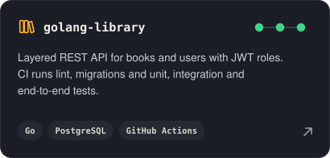
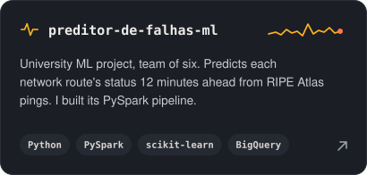

<p align="center">
  
</p>

I'm Guilherme. I study Computer Science and build backend services and LLM tools, mostly in Go, TypeScript and Python. At LinkedIn I'm an intern on the pricing team, where I build the APIs and AI tools the team works with.

Before Computer Science I studied Production Engineering, and that's where my interest in process improvement started. A lot of what I've built since then began with someone doing a task by hand, every week or every month, that software could do instead.

## What I've shipped at work

```diff
@@ LinkedIn · internal hackathon, 1st place @@
- About 25 minutes to put together each client presentation
+ A TypeScript app that pulls Salesforce, Tableau and Trino data into slides
+ An LLM writes the insights on the sales funnel chart
+ A 3-minute review instead, used by about 80 sellers

@@ LinkedIn · team chatbot @@
- About an hour of manual queries for each stakeholder question
+ A LangChain chatbot that answers 2,000 to 3,000 questions a month
+ Answer quality tracked in a Copilot Studio dashboard

@@ LinkedIn · API for AI tools @@
- About 40 seconds for a SQL query behind the API
+ 1.4 seconds with a cache in the Go API on Azure Functions
+ Registered in Azure so AI tools like Superblocks can query it

@@ Höganäs · purchasing @@
- About 400 invoices checked by hand every month
+ A Python RPA that reads the invoice XML files
+ About 50 hours of work saved a month
```

At the hackathon, my team of 6 took first place out of 3 teams. I built the app, its data integrations and the backend in TypeScript, with automated tests. The chatbot and the API run on a Microsoft Fabric Lakehouse that I also built for the team.

## Projects

In my own projects I write Go APIs with Postgres, tests and CI, and I usually explain each design decision in the README.

<a href="https://github.com/g-tavares14/go-url-shortener"></a>
<a href="https://github.com/g-tavares14/go-auth-api"></a>
<a href="https://github.com/g-tavares14/golang-library"></a>
<a href="https://github.com/g-tavares14/preditor-de-falhas-ml"></a>
<a href="https://meirellespsico.com.br"></a>
<a href="https://github.com/g-tavares14/codewars-sync"></a>

<details>
<summary><code>go-url-shortener</code> drops a click when its queue is full</summary>

A redirect puts each click on a buffered channel and responds right away, and a goroutine writes the clicks to Postgres later. If the queue fills up, the click is dropped: losing a count is better than a slow redirect. On shutdown, the server finishes the open requests and saves the clicks still waiting in the queue.

</details>

<details>
<summary><code>go-auth-api</code> checks a password even for an email that doesn't exist</summary>

A login with an unknown email still compares the password against a fake hash, so the response takes the same time and doesn't reveal which emails are registered. Each token also carries an HMAC of the password hash, which means changing the password invalidates every older token.

</details>

<details>
<summary><code>golang-library</code> fails a database test instead of skipping it</summary>

Tests run in GitHub Actions against a throwaway Postgres. In CI, a database test that can't find its database fails instead of being skipped, so no test can "pass" without running.

</details>

<details>
<summary><code>preditor-de-falhas-ml</code> compares each route with its own history</summary>

A 110 ms ping is normal between Brazil and the US and would be ten times the usual inside Brazil, so the model compares each route with its own history. The model is a scikit-learn Random Forest that predicts each route's status 12 minutes ahead, behind a Go API. My part of this six-person university project was the PySpark pipeline that computes that history.

</details>

<details>
<summary><code>meirellespsico.com.br</code> counts visits without cookies</summary>

The front end is static TypeScript served from S3 through CloudFront, with Go services for data collection. Visits are counted by a collector of my own that doesn't use cookies, and Google Tag only loads after the visitor accepts. GitHub Actions tests every change and deploys with short-lived OIDC credentials.

</details>

<details>
<summary><code>codewars-sync</code> makes one commit per kata, or none</summary>

The solution and the kata description go into a single commit through the GitHub Git Data API. If nothing changed, there's no commit, because the new tree has the same SHA as the old one.

</details>

## Right now

<p align="center">
  
</p>

<p align="center">
  <a href="https://www.codewars.com/users/g-tavares14"></a>
</p>

My Codewars solutions land in [codewars-solutions](https://github.com/g-tavares14/codewars-solutions) by themselves: [codewars-sync](https://github.com/g-tavares14/codewars-sync) commits each one when I hit Submit. The card above comes from the Codewars API, drawn every 6 hours by [a small Go program](tools/codewars-card) in this repo. Besides the Go book, I like reading technical books in general.

I hold the AWS Certified AI Practitioner and AWS Certified Cloud Practitioner certifications. Day to day I use Claude Code to write tests before the code, review changes and debug, and I connect Claude to my work tools through MCP servers.

At LinkedIn I also run the mentorship program for LinkedIn Marketing Solutions, where I matched 30 mentor and mentee pairs.

If you want to talk about Go backends, LLM apps or automation, find me on [LinkedIn](https://www.linkedin.com/in/gtavares14/) or write to g.tavares14@icloud.com.
